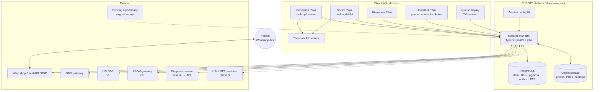
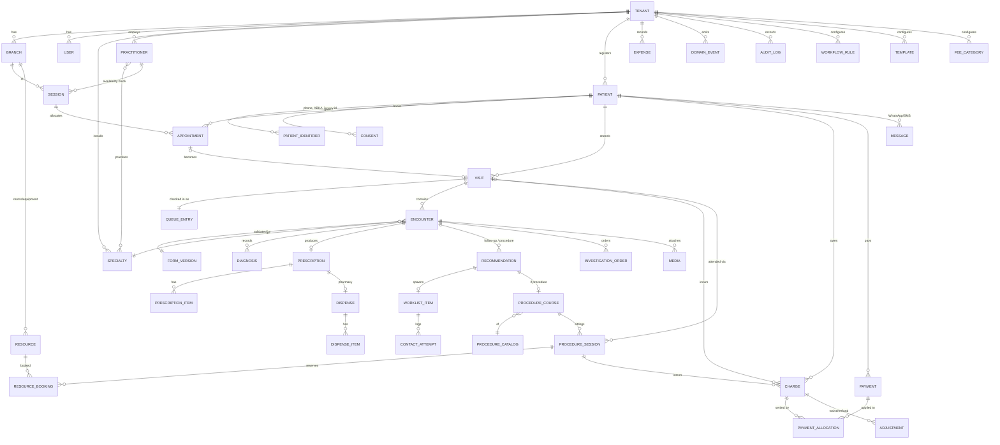

# CUBOTT Clinical — Architecture & Product Assessment

**Version:** 0.1 draft · **Date:** 16 October 2026
**Inputs:** PRD v0.1 (15 Oct 2026); Customer Discovery – Sahitya Dermatology Hospital (29 Sep 2026)
**Audience:** founder/product, engineering lead, clinic stakeholders

Labels used throughout: **OBSERVED** (from discovery), **PRD** (stated in the PRD), **DEVIATION** (I recommend something different from the PRD, with reasons), **ASSUMPTION** (needed to proceed; says what changes if wrong), **Q-n** (open question, collected in the last section).

---

## 0. Executive summary

**What we are building.** A multi-tenant, white-label clinic operations platform for small Indian clinics. First tenant: Sahitya Dermatology Hospital, Rajahmundry (60–70 OPs/day, peaks ~100; two doctors; three procedure rooms growing to six; a separate pharmacy counter on an unrelated "e-pharmacy" system).

**The one thing the clinic actually needs.** Not digitised paper. The clinic loses time at four hand-offs: (1) phone → booking → arrival re-registration, (2) doctor's handwritten plan → reception reading the file → procedure book → two reminder phone calls per procedure, (3) prescription → pharmacy on a disconnected system with a hand-copied patient ID, (4) system collection report → handwritten ledger → doctor reconciling at night. Every architecture decision below is judged on whether it kills one of those hand-offs.

**Headline recommendations.**

1. **Stack is fine.** TypeScript + PostgreSQL + Drizzle is a good fit. Multi-tenancy via a shared schema with `tenant_id` on every row plus Postgres Row-Level Security. Config-heavy requirements are served by JSONB + JSON Schema, not by a bespoke metadata engine. No reason to deviate.
2. **Modular monolith, one deployable, Postgres for everything** (data, job queue via pg-boss, event outbox, full-text search). No Redis, no Kafka, no microservices. A 2–4 person team cannot run anything else.
3. **Specialty is configuration, not code.** A "specialty pack" is a versioned bundle of forms, templates, vitals, procedure catalogue and prescription favourites. Dermatology is the first pack; ENT is the proof that the engine is generic. The clinic owns a forked copy and edits it in the admin UI.
4. **Six deviations from the PRD** (Section 2), the largest being: pull a thin **pharmacy hand-off** (digital Rx visible at the pharmacy counter, dispense record, no inventory) and **WhatsApp reminders** into MVP; model **charges/payments as a ledger** from day one so procedure packages and GST do not require a rewrite; add an **assistant/nurse intake** role; build **tenant + specialty + branch** modelling now even though the first customer is single-site.
5. **Offline is a degraded-mode PWA**, not an offline-first sync engine: cached reads of today's queue and patients, a small write queue for check-in and encounter drafts with idempotency keys, local printing. Full offline parity with the current desktop app is deliberately out, and this must be confirmed with the clinic (Q-1).
6. **AI-ready means three things done now:** every state change is a typed domain event in an outbox table; clinical data is captured as structured JSON validated by schema with provenance fields; every mutating command is also exposed as a permission-scoped, approvable "tool" so a future agent calls exactly what a human clicks.
7. **Cost target** of roughly ₹300–800 per clinic per month marginal on a shared ₹15–20k/month base is achievable (Section 4.10).

**Biggest risks (ranked):** offline expectation mismatch; the doctor not adopting typed documentation (mitigated by assistant intake, favourites and later voice); GST exposure on cosmetic procedures the PRD treats as out of scope; WhatsApp template approval and consent; data migration from an unknown local app.

**Open questions:** 28, numbered in Section 10. Nine of them block the data model or MVP scope and are marked ⚠.

---

## 1. Domain walkthrough

### 1.1 The patient journey as it runs today

```mermaid
flowchart LR
  subgraph Before["Day before / morning"]
    A0[Doctor tells team availability & breaks] --> A1[Reception estimates OP capacity per hour window]
  end
  subgraph Booking["07:00–09:30 phone rush (90% of bookings)"]
    B1[Call: name + phone only] --> B2{Capacity in window?}
    B2 -- yes --> B3[Offer window + 'arrive ~35 min early']
    B2 -- unsure --> B4[Check with doctor, call back]
  end
  subgraph Arrival
    C1[Find/register patient<br/>location, weight, complaint] --> C2[Pick category<br/>New/Renewal/Free/Nightly/Special/Online] --> C3[Collect/waive fee<br/>cash or UPI] --> C4[Daily OP number, paper file] --> C5[Live queue, judgement calls]
  end
  subgraph Consult
    D1[Doctor reads paper file] --> D2[History, exam, Dx] --> D3[Handwritten Rx + follow-up + procedure rec]
  end
  subgraph After["After consultation"]
    E1[Reception reads file] --> E2[Procedure book / follow-up book] --> E3[Pharmacy dispenses from handwritten Rx<br/>manually keyed patient ID]
    E1 --> E4[Diagnostic request on paper → centre portal → print → staple]
  end
  subgraph Procedure["Procedure timeline (days–weeks)"]
    F1[Call ~1 week before] --> F2[Call 1–2 days before] --> F3[Day-of: room, equipment, provider, duration] --> F4[Session outcome: done/missed/cancelled/postponed] --> F5[Photos on phone → laptop folder]
  end
  subgraph Money["End of day"]
    G1[2-page collection report cash vs UPI] --> G2[Handwritten income/expense ledger] --> G3[Doctor reconciles 'when time permits']
  end
  A1 --> B1
  B3 --> C1
  C5 --> D1
  D3 --> E1
  D3 --> F1
  C3 --> G1
```



### 1.2 Where time is lost, by role

| Role | Step | What is repeated or wasted | Generic or specialty-specific |
|---|---|---|---|
| **OP receptionist** | Phone booking | Writes name+phone, later re-keys full registration at arrival. Cannot confirm availability without checking with doctor. Mental arithmetic of capacity per window. | Generic |
| | Arrival | Decides visit category by memory (15-day renewal rule from payment date). Hand-assigns daily OP number per category. | Generic (rules are tenant config) |
| | Queue | Manual judgement for late/no-show/walk-in; nobody else can see the queue. | Generic |
| | Post-consult | Reads doctor's handwriting, copies follow-up/procedure into books, explains to patient. | Generic hand-off; the *content* is specialty-specific |
| | End of day | Prints system report, re-writes collections in ledger, adds expenses. | Generic |
| **Procedure coordinator** | Recommendation | Same recommendation written twice (file + book). | Generic |
| | Reminders | Two phone calls per procedure per patient; outcome of call is in their head. | Generic |
| | Scheduling | Room/equipment/provider/duration in head. Duration for same procedure varies 10 min–4 h. | Scheduling engine generic; catalogue and duration rules specialty-specific |
| | Course tracking | Sessions completed/remaining, paid/outstanding per sitting, tracked in a book. | Generic (any multi-session therapy: derm lasers, physio, dental, ortho injections) |
| **Doctor** | Consult | No history view; asks the same history every visit. Writes the same drugs for acne/psoriasis daily by hand. In room 12:00–19:30 without a break. | History view generic; templates, vitals, drug favourites specialty-specific |
| | Admin | Is the only administrator; reconciles money at night. | Generic |
| **Pharmacy** | Dispense | Reads handwriting, keys patient ID manually into separate system, bill never linked to visit. | Generic |
| **Assistant / junior doctor** | Pre-screen | Doctor says this *could* happen; does not today. | Intake questions are specialty-specific |
| **Patient** | Everything | Told "wait 30–45 min" with no visibility; receives two calls per procedure; carries paper. | Generic |

### 1.3 Generic vs specialty-specific, summarised

**Generic to every Indian small clinic (code):** patient identity, visit, appointment window + capacity, queue, encounter lifecycle, prescription printing, worklists (follow-up, procedure), course/session model, resources and conflict detection, charges/payments/ledger, consent, media, audit, messaging, reporting, roles.

**Specialty-specific (configuration, via specialty pack):** intake question sets per complaint, encounter form sections and fields, vitals set (derm: weight only; pediatrics: weight/height/HC/temp; ENT: audiometry fields), examination templates, diagnosis favourites, drug favourites and dosing patterns, procedure catalogue with duration rules and equipment tags, follow-up defaults, photo "body area" vocabularies, print layouts, message wording.

**Clinic-specific (configuration, per tenant):** fee categories and rules, numbering, working hours, rooms, roles and user overrides, branding, languages, which channels are on.

---

## 2. PRD critique

The PRD is unusually careful about separating observed vs proposed and about not hardcoding decisions. Its workflow distinctions (§2.3) are correct and should be preserved verbatim in the domain model. The critique below is about scope and framing.

### 2.1 Gaps

| # | Gap | Evidence | Consequence if ignored |
|---|---|---|---|
| G1 | **Framed as a single dermatology clinic app** ("Build a connected clinic … for a dermatology clinic", §1.1; "do not add multi-location complexity", §4). | Business goal says multi-tenant, multi-specialty, white-label. | Retrofitting `tenant_id`, branch and specialty later touches every table and every query. Cheapest on day one. |
| G2 | **Pharmacy excluded** (§1.3) but pharmacy staff are a primary user in the brief, and discovery shows the hardest data break in the clinic (manual patient-ID bridge, bills unlinked). | Discovery §1 pharmacy section, §3 table. | The handwritten Rx remains the pharmacy's input; the doctor's "typed" Rx becomes extra work with no downstream benefit. |
| G3 | **No assistant / nurse / junior-doctor persona**, though complaint-specific intake questions are in scope (§5.7, §6.4) and the doctor explicitly asked for pre-screening. | Discovery Step 8. | The single biggest doctor-time lever has no owner in the role model. |
| G4 | **GST not considered** beyond "not assumed". | Consultations by clinical establishments are GST-exempt, but **cosmetic procedures** (hydrafacial, laser hair reduction, many derm packages) are generally **taxable at 18%**, and **pharmacy medicine sales are taxable**. A ₹20,000 course is likely an invoice the clinic must issue correctly. | A payments table without tax and invoice lines has to be rebuilt. |
| G5 | **Procedure packages, per-sitting payment, outstanding amounts** are "confirm" in the PRD (§6.5, §11) but discovery states outstanding-amount reporting is a desired view and per-sitting payment happens. | Discovery Step 11, §5. | The reporting the owner wants cannot be produced from "a payment against a visit". |
| G6 | **WhatsApp relegated to "evaluate"** (§9). | Market constraint: WhatsApp-first patients. Two reminder calls per procedure patient is the coordinator's main load. | Leaves the largest rule-based automation on the table. |
| G7 | **Offline left as "confirm"** (§11) while the incumbent is a local app that "works without internet". | Discovery §4. | A cloud SaaS that goes blank when the Jio link drops at 10:30 on a Monday will be rejected in week one. |
| G8 | **Photo capture path not specified.** Photos are taken on a mobile phone (OBSERVED). "Capture/upload" implies a desktop flow. | Discovery Step 11. | Without a phone-first upload (PWA camera or WhatsApp inbound), photos stay on the phone. |
| G9 | **Diagnostics** only as "attach document". No investigation order entity. | Discovery Step 10. | Doctor cannot see "test ordered, result pending" in the timeline. Small entity, large visibility gain. |
| G10 | **Consent for messaging and DPDP notice** not mentioned anywhere except photos. | DPDP Act 2023 requires notice + purpose-bound consent for processing; WhatsApp requires opt-in. | Legal exposure and WhatsApp account quality downgrade. |
| G11 | **Doctor-side queue action** ("call next", "mark seen") unspecified. Queue is written entirely from reception's view. | §6.3. | Doctor keeps shouting the next name; queue status drifts from reality. |
| G12 | **Language.** Hindi/Telugu for staff UI and patient messages not mentioned. | Market constraint; clinic is in Andhra Pradesh (Telugu). | Patient messages in English only reduce confirmation rates. |

### 2.2 Contradictions and risky assumptions

- **C1.** §4: "Do not add multi-location complexity unless required" vs business goal "multi-branch". Resolution: model `branch` now, expose branch UI only when a tenant has more than one.
- **C2.** §6.5 "Do not build package billing until confirmed" vs §6.8 scenario "partial payment or outstanding amount" and discovery's outstanding-amount report. Resolution: build the ledger primitives (charge, payment, allocation); packages become a *pricing rule* on top later.
- **C3.** §2.3 says "doctor is different from operational staff", but the owner is both doctor and the only administrator. The permission model must allow one user to hold multiple roles, and "owner" cannot be a role that implies clinical access by default (a non-clinical owner is common in multi-doctor clinics).
- **R1.** "Doctor could be optional at booking" (discovery) while capacity is per doctor. Risky: capacity must be computable for a *pooled* session. Resolution: capacity is defined per `session` (a block of time on a doctor's calendar); a booking may target a doctor or the pooled OP session; pooled capacity = sum of session capacities minus allocations.
- **R2.** "Around 7 OPs per hour, 7 minutes each" are examples, not rules (discovery says so). The PRD correctly makes capacity configurable. The risk is building a *predictive* capacity model in MVP. Keep it a configured integer per session with a one-click override and an audit row.
- **R3.** Daily OP number "starts from 1 separately for each category" is reported but unconfirmed (Q-6 ⚠). Numbering must be a configurable sequence with scope = tenant × branch × day × optional category.
- **R4.** Reference-product research (§10) is product work, not engineering. Fine to keep, but it must not gate implementation.

### 2.3 Over- and under-scoped

| Over-scoped for MVP | Why |
|---|---|
| Exclusive equipment reservations with equipment *downtime calendars* (§5.6) | OBSERVED: equipment is fixed in a room. Model equipment as capability tags on rooms. Conflict detection on rooms and practitioners only. Movable equipment as a resource type is a later toggle, not a rewrite. |
| Google Calendar sync (§9) | Two-way sync is a swamp. Out until asked twice. |
| Duplicate *merge* (§6.1) | Duplicate *warning* ships; merge is admin-only and can be a support script for months. |
| Before/after image comparison tooling (§6.7) | Side-by-side with date is enough. Overlays/alignment later. |

| Under-scoped for MVP | Why |
|---|---|
| Pharmacy hand-off (G2) | See Deviation D1. |
| WhatsApp reminders (G6) | See Deviation D2. |
| Expense entry | The handwritten ledger exists only because the system has no expense line. A single table and one form removes a daily book and the doctor's nightly reconciliation. |
| Assistant intake (G3) | See Deviation D4. |
| Charge/payment ledger (G4, G5) | See Deviation D3. |

### 2.4 Explicit deviations from the PRD

| ID | PRD says | I recommend | Reasoning |
|---|---|---|---|
| **D1** | Pharmacy out of scope (§1.3) | **MVP: thin pharmacy hand-off.** Pharmacy counter sees the completed Rx by patient/OP number, marks items dispensed/substituted/not available, creates a pharmacy bill linked to the visit. **No inventory in MVP**; batches/expiry in v1. | Discovery's loudest cross-system pain. Cost ≈ 8–10 dev-days. Makes the typed Rx worth typing. Inventory stays out because it is a product in itself. |
| **D2** | WhatsApp: evaluate (§9) | **MVP: outbound templated WhatsApp** for booking confirmation, procedure 7-day and 2-day reminders with Yes/No quick replies, follow-up due. Phone call remains the fallback and is logged. | Replaces two calls per procedure patient. Utility template cost is low (≈ ₹0.12–0.15 per message; verify current Meta pricing). Risk is template approval time, so start the BSP onboarding in week 1. |
| **D3** | Payment recorded against visit; packages/GST deferred (§6.5, §6.8, §1.3) | **Ledger primitives in MVP:** `charge` (with tax fields, default 0), `payment`, `payment_allocation`, `adjustment` (waiver/refund). Packages and GST invoices in v1 as *rules and templates* on these tables. | Avoids a rewrite. Produces the outstanding-amount and per-sitting views the owner asked for. Tax fields cost nothing now. |
| **D4** | No assistant role; intake is a doctor feature | **Add `assistant` role and an intake step** in the queue: vitals + complaint-specific questions captured before the doctor, shown as a pre-filled draft the doctor accepts or edits. | The doctor's own suggestion. Shifts 2–4 minutes per patient off the doctor. Zero new entities: it is an encounter section with a different author. |
| **D5** | Single clinic, no multi-location (§1.1, §4) | **Tenant → branch → specialty → practitioner modelled from day one**; UI hides branch when count = 1. | Business goal. Retrofit cost is total. |
| **D6** | Offline: confirm (§11) | **Degraded-mode PWA** with cached reads, a bounded write queue, and local printing. Explicitly *not* offline-first sync. | Full sync is months of work and conflict-resolution UX nobody wants. Degraded mode covers the 2–20 minute outages that actually happen. If the clinic requires hours-long offline operation (Q-1 ⚠), the answer is an on-prem edge box running the same container, not a sync engine. |

Everything else in the PRD scope is accepted as written.

---

## 3. Automation catalogue

Legend: **RB-MVP** rule-based, ships in MVP · **AI-later** AI-assisted · **Voice-later** voice agent. Effort saved is per occurrence at Sahitya's volumes; complexity is engineering effort in dev-days (d).

### 3.1 OP receptionist

| # | Automation | Class | Saves | Complexity |
|---|---|---|---|---|
| R1 | **Phone number lookup on booking**: typing a number shows matching patients (family members separately), one click to book. | RB-MVP | 30–60 s × 70/day | 1 d |
| R2 | **Capacity-aware window picker**: windows show `allocated / capacity`, greyed when full, override with reason. | RB-MVP | Removes call-backs; ~5 min/day of doctor interruptions | 3 d |
| R3 | **Booking confirmation message** with window and "arrive by" time, in patient's language. | RB-MVP | 1 clarification call per 5 bookings | 2 d (on top of messaging module) |
| R4 | **Auto-suggest visit category**: last paid consult within N days → Renewal (₹0); open procedure course → Free; referral card on record → Special. Receptionist confirms. | RB-MVP | 10–20 s × 70/day + fewer fee disputes | 2 d |
| R5 | **Auto daily OP number** per configured scope. | RB-MVP | Trivial but error-prone today | 1 d |
| R6 | **One-screen arrival**: find → prefilled registration → category → fee → check-in, keyboard-only. | RB-MVP (UX) | 1–2 min × 70/day | 5 d |
| R7 | **Recommendations auto-flow to worklists**: doctor's follow-up/procedure recommendation creates the worklist item; reception sees "explain to patient" checklist on the post-consult screen. | RB-MVP | Reading handwriting + re-copying, ~2 min per patient with a plan | 3 d |
| R8 | **No-show / late detection**: patient not checked in 15 min after window end flagged; one-tap "send reminder" or "mark no-show". | RB-MVP | Eyes-on-list time | 1 d |
| R9 | **Backfill suggestion**: when a slot frees, list later-window patients already checked in or nearby (by last location). | RB-MVP | Judgement support | 2 d |
| R10 | **Daily collection auto-reconciled**: cash vs UPI totals plus expenses entered in-app; variance shown. | RB-MVP | Removes handwritten ledger; 20–30 min/day; doctor's nightly reconciliation | 3 d |
| R11 | **Incoming call screen-pop** via telephony (Exotel/Knowlarity): caller's record opens before "hello". | AI-later (telephony integration, not AI) | 20 s × 60 calls/day | 5 d + vendor |
| R12 | **WhatsApp self-booking**: patient sends "book", bot offers windows from the same capacity engine. | Voice/agent-later | Up to 90% of calls in the 07:00–09:30 rush | 10 d once agent layer exists |
| R13 | **Voice booking agent** answering the phone during the rush, writing tentative bookings for reception to confirm. | Voice-later | Same as R12 for non-WhatsApp callers | 15 d + vendor |

### 3.2 Doctor

| # | Automation | Class | Saves | Complexity |
|---|---|---|---|---|
| D1 | **Patient timeline on open**: last 3 encounters, active meds, allergies, open course, pending tests, last photos. | RB-MVP | Re-asking history, ~1 min/returning patient | 4 d |
| D2 | **Assistant intake pre-fill** (Deviation D4). | RB-MVP | 2–4 min/patient | 4 d |
| D3 | **Drug favourites and regimen templates** per doctor and per diagnosis ("Acne grade 2 kit"), one tap inserts 4 items with dose/frequency/duration. | RB-MVP | 1–2 min/Rx | 3 d |
| D4 | **Repeat last prescription** with edits, for renewals. | RB-MVP | 1–2 min on ~30% of visits | 1 d |
| D5 | **Follow-up default by diagnosis/procedure** ("review in 2 weeks") pre-selected. | RB-MVP | 10 s + fewer missed follow-ups | 1 d |
| D6 | **Procedure recommendation from catalogue** with duration estimate pre-filled, doctor adjusts. | RB-MVP | 30 s | included in catalogue |
| D7 | **Call next / mark in-consult** from the doctor's screen, drives queue display. | RB-MVP | Shouting and door-opening | 1 d |
| D8 | **Print on complete**: Rx prints to the room printer automatically on "complete encounter". | RB-MVP | 3 clicks × 70 | 1 d |
| D9 | **Ambient scribe**: consult audio → transcript → structured draft of the encounter form; doctor reviews. | AI-later | 2–4 min/patient; the big one | 15–20 d + model cost |
| D10 | **Photo auto-tagging**: body area, lesion type suggestion, auto-link to open course. | AI-later | 20 s/photo | 5 d |
| D11 | **Drug interaction / allergy warning** against recorded allergies and active meds. | RB-MVP (allergy match) / AI-later (interactions) | Safety | 1 d / 5 d + dataset |
| D12 | **Voice commands in consult** ("add tretinoin 0.025 nightly 8 weeks"). | Voice-later | Typing | 8 d on top of D9 |

### 3.3 Procedure coordinator

| # | Automation | Class | Saves | Complexity |
|---|---|---|---|---|
| P1 | **Worklist of unscheduled recommendations** with missing-info flags. | RB-MVP | Procedure book lookups | included in worklist |
| P2 | **Resource-aware slot finder**: given procedure + duration + provider, list feasible room/time slots; hard-block capability mismatch. | RB-MVP | 2–5 min per scheduling + prevents wrong-room errors | 6 d |
| P3 | **7-day and 2-day WhatsApp reminders with Yes/No**; reply updates session to confirmed/needs-call; non-responders become a call task. | RB-MVP | Two calls × ~10 procedures/day → calls only for non-responders | 4 d |
| P4 | **Course progress and balance** visible per patient: sessions done/remaining, paid/outstanding. | RB-MVP | Book arithmetic | 2 d (on ledger) |
| P5 | **Day sheet**: today's sessions by room with prep instructions and consent status. | RB-MVP | 15 min/morning | 2 d |
| P6 | **Postpone/cancel cascades**: doctor leave → list affected sessions, bulk-send "please call us" message, keep history. | RB-MVP | Hours on a leave day | 3 d |
| P7 | **Duration prediction** per procedure × area × patient history. | AI-later | Better packing of rooms | 5 d + data |
| P8 | **Voice/WhatsApp agent negotiates reschedule** with patient within constraints, proposes to coordinator for approval. | Voice-later | Remaining calls | 10 d on agent layer |

### 3.4 Pharmacy

| # | Automation | Class | Saves | Complexity |
|---|---|---|---|---|
| F1 | **Rx appears at counter** by OP number/QR on the printed Rx; dispense checkboxes; bill linked to visit. | RB-MVP (Deviation D1) | Handwriting reading, re-keying ID; ~1 min/Rx | 8 d |
| F2 | **Substitution/not-available feedback** to doctor's favourites ("you keep prescribing X, we stock Y"). | RB-MVP | Patient walking back to doctor | 1 d |
| F3 | **Batch/expiry inventory, GST pharmacy invoice, near-expiry alerts.** | v1 (rule-based) | Separate app and manual stock-taking | 20 d |
| F4 | **Reorder suggestions** from dispensing velocity. | AI-later (simple stats first) | Stock-outs | 3 d |

### 3.5 Owner / admin, assistant, patient

| # | Automation | Class | Saves | Complexity |
|---|---|---|---|---|
| O1 | **Daily owner summary on WhatsApp** at close: OPs by category, collections cash/UPI, outstanding, tomorrow's procedures. | RB-MVP | Nightly report reading | 2 d |
| O2 | **Weekly/monthly analytics**: volume, revenue by doctor/category/procedure, follow-up completion, no-show rate. | RB-MVP (v1 polish) | Decision-making the owner cannot do today | 5 d |
| O3 | **Natural-language questions over reports** ("how many hydrafacials in September, revenue?"). | AI-later | Ad hoc analysis | 5 d on event/report layer |
| A1 | **Assistant intake queue**: who is waiting for vitals/intake, complaint-specific question set auto-selected from main complaint. | RB-MVP | Enables D2 | included in D2 |
| PT1 | **Queue position / "your turn in ~N" messages** to the patient. | RB-MVP (v1) | Front-desk "how long?" questions | 2 d |
| PT2 | **Post-visit Rx PDF and care instructions** on WhatsApp. | RB-MVP (v1) | Lost paper Rx; pharmacy re-visits | 2 d |
| PT3 | **WhatsApp agent** for booking, rescheduling, FAQs, in Telugu/Hindi/English. | Voice/agent-later | Calls | see R12 |

**Net effect at MVP, rough:** reception ≈ 1.5–2 h/day; coordinator ≈ 1 h/day plus most reminder calls; doctor ≈ 1–2 min/patient (≈ 1–1.5 h/day) before any AI; pharmacy ≈ 1 min/Rx. The AI phase roughly doubles the doctor saving.

---

## 4. Architecture

### 4.1 System context



### 4.2 Multi-tenancy

**Decision: shared database, shared schema, `tenant_id` on every tenant-scoped row, enforced by Postgres Row-Level Security, with the tenant set per transaction.**

| Option | Isolation | Ops cost at 50 tenants | Drizzle fit | Verdict |
|---|---|---|---|---|
| **Shared schema + RLS** | Logical, DB-enforced | One DB, one migration | Native (`pgPolicy`, one schema) | **Chosen** |
| Schema per tenant | Stronger logical | 50 × migrations, connection pool per schema, catalog bloat | Poor: Drizzle migrations assume one schema; `search_path` juggling | Rejected |
| Database per tenant | Strongest | 50 databases, 50 backups, cross-tenant analytics impossible | Workable but operationally expensive | Rejected for small clinics; keep as an *option* for a hospital that demands it (same code, different connection string) |

Trade-offs accepted: noisy-neighbour risk (mitigated by statement timeouts and per-tenant rate limits), one blast radius for a bad migration (mitigated by staged rollout and PITR), and discipline required so no query bypasses RLS (mitigated by the app role having no `BYPASSRLS` and every request running inside `withTenant`).

```ts
// db/tenant.ts — every request's work happens inside this
export async function withTenant<T>(tenantId: string, userId: string, fn: (tx: Tx) => Promise<T>) {
  return db.transaction(async (tx) => {
    await tx.execute(sql`select set_config('app.tenant_id', ${tenantId}, true),
                                set_config('app.user_id',   ${userId},   true)`);
    return fn(tx);
  });
}
```

```sql
-- applied to every tenant-scoped table by a migration helper
alter table patient enable row level security;
alter table patient force row level security;
create policy tenant_isolation on patient
  using (tenant_id = current_setting('app.tenant_id')::uuid)
  with check (tenant_id = current_setting('app.tenant_id')::uuid);
```

```ts
// drizzle: tenant column + composite indexes always lead with tenant_id
export const tenantCols = {
  id: uuid('id').primaryKey().defaultRandom(),
  tenantId: uuid('tenant_id').notNull().references(() => tenant.id),
  createdAt: timestamptz('created_at').notNull().defaultNow(),
  updatedAt: timestamptz('updated_at').notNull().defaultNow(),
};
```

**Tenant config** lives in two places: typed columns for things code branches on (`locale`, `timezone`, `plan`), and a `tenant_setting` table keyed by namespace for everything else, validated against a JSON Schema per namespace. White-labelling = `branding` namespace + custom domain row.

### 4.3 Multi-specialty and multi-branch

```
tenant (Sahitya Dermatology Hospital)
 ├─ branch (Main, Rajahmundry)         ← physical location, its own rooms, numbering, hours
 │   ├─ room / resource
 │   └─ session (doctor × date × time block × capacity)
 ├─ specialty (Dermatology)            ← pack instance: forms, templates, catalogue
 ├─ specialty (Cosmetology)            ← second pack, same tenant
 ├─ practitioner (Dr A) ─┬─ specialties: [Dermatology, Cosmetology]
 └─ practitioner (Dr B) ─┘  works at: [Main]
```

- A **practitioner** has one or more specialties and one or more branches.
- An **encounter** carries `specialty_id` (defaulted from the practitioner, overridable), which selects the form definitions and templates.
- **Catalogues** (procedures, drug favourites, diagnosis favourites) are scoped `tenant × specialty`, with `branch_id` nullable for branch-specific pricing.
- **Patients and ledgers** are tenant-scoped, not branch-scoped: a patient seen at two branches is one record.
- **Numbering sequences** are scoped by a configurable key (`branch`, `branch+category`, `tenant`).

A **specialty pack** is a seed: a JSON bundle (`forms[]`, `templates[]`, `vitals`, `procedures[]`, `favourites[]`, `followup_defaults`) with a version. Installing a pack copies rows into the tenant with `source_pack = 'dermatology@1.2'`. The tenant edits freely; pack upgrades are offered as a diff, never applied silently.

### 4.4 Configurability engine: what is configuration, what is code

| Concern | Configuration (admin UI, JSON, no deploy) | Code |
|---|---|---|
| Fields & forms | Field definitions, sections, visibility conditions, validation, per-specialty form versions | Rendering engine, storage, versioning |
| Clinical vocab | Favourites, complaint → intake question set mapping, body-area lists | Nothing |
| Templates | Rx print layout, receipt, WhatsApp/SMS text, letterhead, labels (Liquid templates) | Template engine, PDF renderer |
| Fees | Categories, amounts, eligibility rules (JSONLogic), effective dates, tax rates | Rule evaluator, ledger math, rounding |
| Scheduling | Session capacity, window size, arrive-early minutes, overbooking permission, procedure durations and buffers, room capabilities | Conflict detection, capacity arithmetic |
| Workflow | Reminder offsets, which events send which template, who owns overdue items, approval requirements | State machines (encounter, session, course, payment), event emission |
| Access | Roles → permissions, per-user grants/denies, field-level clinical masks | Permission check, audit |
| Numbering | Pattern, scope, reset policy | Sequence allocation (row-locked) |
| Branding & locale | Name, logo, colours, languages, domain | i18n framework |

**Design principle:** state machines and money stay in code. Everything that varies between clinics is data validated by schema. No general-purpose "workflow designer" in MVP: a `workflow_rule` row is `on event X, if JSONLogic condition, do one of a fixed list of actions`. That covers reminders, worklist routing, and notifications without inventing a BPMN engine.

#### Form definitions (JSON Schema + UI hints)

```json
{
  "key": "derm.encounter.v3",
  "specialty": "dermatology",
  "version": 3,
  "sections": [
    {"key": "complaint", "title": {"en": "Complaint", "te": "ఫిర్యాదు"}, "fields": [
      {"key": "chief_complaint", "type": "text", "required": true, "fhir": "Condition.code.text"},
      {"key": "duration", "type": "duration", "units": ["days","weeks","months","years"]},
      {"key": "site", "type": "body_map", "vocab": "derm.body_areas", "multi": true}
    ]},
    {"key": "exam", "title": {"en": "Examination"}, "fields": [
      {"key": "morphology", "type": "multiselect", "vocab": "derm.morphology"},
      {"key": "distribution", "type": "select", "vocab": "derm.distribution"},
      {"key": "photos", "type": "media", "accept": "image/*", "consent_required": true}
    ]},
    {"key": "assessment", "fields": [
      {"key": "diagnoses", "type": "diagnosis_list", "favourites": "derm.dx", "coding": "ICD-10"},
      {"key": "severity", "type": "select", "options": ["mild","moderate","severe"],
       "visible_if": {"in": [{"var": "assessment.diagnoses[0].code"}, ["L70.0","L40.0"]]}}
    ]},
    {"key": "plan", "fields": [
      {"key": "prescription", "type": "prescription", "favourites": "derm.rx"},
      {"key": "procedures", "type": "procedure_recommendation"},
      {"key": "followup", "type": "followup", "default_by_dx": "derm.followup_defaults"},
      {"key": "investigations", "type": "investigation_order"}
    ]}
  ]
}
```

Field types are a fixed, code-implemented set (~15). "Dermatology vs ENT" is only a different JSON document:

```json
{
  "key": "ent.encounter.v1",
  "specialty": "ent",
  "sections": [
    {"key": "complaint", "fields": [
      {"key": "chief_complaint", "type": "text", "required": true},
      {"key": "side", "type": "select", "options": ["left","right","both"]},
      {"key": "duration", "type": "duration"}
    ]},
    {"key": "vitals", "fields": [
      {"key": "temp_c", "type": "number", "min": 34, "max": 42},
      {"key": "spo2", "type": "number", "min": 50, "max": 100}
    ]},
    {"key": "exam", "fields": [
      {"key": "otoscopy_l", "type": "select", "vocab": "ent.tympanic_membrane"},
      {"key": "otoscopy_r", "type": "select", "vocab": "ent.tympanic_membrane"},
      {"key": "nasal_endoscopy", "type": "textarea"},
      {"key": "throat", "type": "multiselect", "vocab": "ent.throat_findings"},
      {"key": "audiometry", "type": "file", "accept": "application/pdf,image/*"}
    ]},
    {"key": "assessment", "fields": [{"key": "diagnoses", "type": "diagnosis_list", "favourites": "ent.dx"}]},
    {"key": "plan", "fields": [
      {"key": "prescription", "type": "prescription", "favourites": "ent.rx"},
      {"key": "procedures", "type": "procedure_recommendation"},
      {"key": "followup", "type": "followup"}
    ]}
  ]
}
```

Storage: `encounter.data jsonb` holds the whole form; `encounter.form_version_id` pins the schema that validated it. Fields that the system *queries* (diagnoses, prescription items, recommendations, vitals) are **also** written to relational tables by the encounter service on save ("dual write inside one transaction"). This is the pragmatic middle: flexible capture, queryable where it matters, no EAV.

#### Sample tenant config (abridged)

```json
{
  "tenant": {"slug": "sahitya", "name": "Sahitya Dermatology Hospital", "locale": "te-IN",
             "languages": ["te","en"], "timezone": "Asia/Kolkata", "currency": "INR"},
  "branding": {"primary": "#0B5D4B", "logo": "s3://.../logo.png", "print_header": "Sahitya Dermatology Hospital, Rajahmundry"},
  "numbering": {
    "patient_id": {"pattern": "SDH-{seq:6}", "scope": "tenant"},
    "op_number":  {"pattern": "{category_code}-{seq}", "scope": "branch+day+category", "reset": "daily"},
    "invoice":    {"pattern": "INV/{fy}/{seq:5}", "scope": "branch+fy"}
  },
  "scheduling": {
    "window_minutes": 60, "arrive_early_minutes": 35,
    "default_capacity_per_window": 7, "overbook": {"allowed": true, "permission": "appointment.overbook"},
    "no_show_after_minutes": 15
  },
  "fee_categories": [
    {"code": "GEN", "name": {"en": "General / New", "te": "సాధారణ"}, "amount": 30000, "tax_rate": 0,
     "eligibility": null, "affects_capacity": true, "priority": 0},
    {"code": "REN", "name": {"en": "Renewal"}, "amount": 0, "affects_capacity": true, "priority": 0,
     "eligibility": {"<=": [{"var": "days_since_last_paid_consult"}, 14]},
     "eligibility_note": "payment day = day 0, day 15 inclusive → 14 days after"},
    {"code": "FREE", "name": {"en": "Free (procedure follow-up)"}, "amount": 0, "affects_capacity": false,
     "eligibility": {"==": [{"var": "has_open_procedure_course"}, true]}},
    {"code": "NGT", "name": {"en": "Emergency / Nightly"}, "amount": 50000, "priority": 10},
    {"code": "SPL", "name": {"en": "RMP/PMP Special Card"}, "amount": 20000, "priority": 0,
     "eligibility": {"==": [{"var": "patient.referral_card"}, true]}},
    {"code": "ONL", "name": {"en": "Online"}, "amount": 50000, "affects_capacity": false, "mode": "online"}
  ],
  "adjustments": {"waiver_reasons": ["known_person", "doctor_instruction", "staff"], "refund_requires": "payment.refund"},
  "worklists": {
    "followup": {"owner_role": "receptionist", "overdue_after_days": 3},
    "procedure": {"owner_role": "procedure_coordinator", "reminders": [{"offset_days": -7, "template": "proc_reminder_7d"},
                                                                      {"offset_days": -2, "template": "proc_reminder_2d"}]}
  },
  "channels": {"whatsapp": {"enabled": true, "bsp": "meta_cloud", "phone_number_id": "..."}, "sms": {"enabled": true, "fallback": true}},
  "specialties": [{"pack": "dermatology@1.2"}, {"pack": "cosmetology@1.0"}],
  "features": {"pharmacy_handoff": true, "inventory": false, "abdm": false, "online_payments": false}
}
```

Amounts are integers in paise. Eligibility is JSONLogic evaluated against a small, documented context object; the receptionist always sees *why* a category was suggested and can override with a reason.

#### Workflow rules

```sql
create table workflow_rule (
  id uuid primary key, tenant_id uuid not null,
  event_type text not null,                 -- 'procedure_session.scheduled'
  condition jsonb,                          -- JSONLogic over event payload, null = always
  action text not null,                     -- 'schedule_message' | 'create_task' | 'notify_role' | 'set_field'
  action_params jsonb not null,             -- {"template":"proc_reminder_7d","offset_days":-7,"channel":"whatsapp"}
  enabled boolean not null default true
);
```

Actions are an enum implemented in code. Adding an action type is a deploy; adding a rule is a row.

#### Permissions

```sql
create table role (id uuid pk, tenant_id uuid, key text, name text, is_system boolean);
create table role_permission (role_id uuid, permission text);      -- 'encounter.write', 'payment.refund'
create table user_role (user_id uuid, role_id uuid, branch_id uuid null);
create table user_permission_override (user_id uuid, permission text, effect text check (effect in ('grant','deny')));
```

Permissions are dotted strings checked in code (`can(user, 'payment.refund')`). Roles are tenant-editable bundles. Clinical read access additionally requires a *relationship* for non-owner doctors (practitioner on the encounter or on the patient's open course) — implemented in the query layer, configurable by tenant flag `clinical_access: 'all_practitioners' | 'assigned_only'`.

### 4.5 Modular boundaries: modular monolith

One TypeScript service, one repository, one deployable, modules with explicit interfaces and no cross-module table access:

```
modules/
  identity      users, roles, sessions, tenant resolution
  config        settings, forms, templates, packs, numbering, workflow rules
  patient       patient, identifiers, consents, duplicate detection
  scheduling    sessions, availability, appointments, capacity
  visit         visit, check-in, queue
  clinical      encounter, prescription, recommendation, investigation, media
  procedure     catalogue, course, session, resources, conflicts
  worklist      follow-up & procedure tasks, contact attempts
  billing       charge, payment, allocation, adjustment, invoice, expense
  pharmacy      dispense, (v1) inventory
  messaging     outbound/inbound messages, templates, providers
  reporting     read models, exports
  platform      events/outbox, jobs (pg-boss), audit, storage, pdf, print
```

Rules: modules call each other through exported service functions, never through each other's tables; cross-module reactions go through domain events; `reporting` is the only module allowed to read any table. This is enough to split a module out later (messaging and reporting are the likely first candidates) without paying the distributed-systems tax now.

**Rejected:** microservices (team size; every integration failure becomes a distributed debugging session), serverless functions (cold starts on low-end connections, hard local dev, poor fit for pg-boss), a separate "config service" (the config *is* the product; it belongs beside the code that interprets it).

**Runtime choices:** Node 22 LTS, Fastify (or Hono) with Zod-validated routes and OpenAPI generation (the OpenAPI doc later doubles as the agent tool catalogue), Drizzle + `postgres.js`, pg-boss for jobs, Liquid for templates, Playwright-Chromium (single shared instance) for PDF, React + Vite PWA with TanStack Query and Workbox on the client. Why the OpenAPI point matters is in Section 7.

### 4.6 Offline and low-connectivity strategy

**Target:** the clinic keeps working through a 2–30 minute outage without anyone noticing; a half-day outage degrades gracefully and is explained on screen; nothing is lost.

| Layer | Mechanism |
|---|---|
| Reads | Service worker caches app shell. TanStack Query persists today's queue, today's appointments, recently opened patients and the patient search index (name + phone + id for all patients; ~70k patients ≈ 5 MB) in IndexedDB. Search works offline. |
| Writes | A bounded **mutation queue** in IndexedDB for a whitelist: check-in, queue reorder, encounter draft save, payment record, intake capture. Each mutation carries a client-generated `idempotency_key` and `client_ts`. Replayed in order on reconnect; server deduplicates on key. UI shows "pending sync" badges. |
| Conflicts | Queue reorders use server timestamps, last-writer-wins, with an audit row. Encounter drafts are per-author; the doctor owns their encounter, so conflicts are rare and surface as "server has newer draft, keep which?". Payments never merge: a duplicate key is rejected, not re-applied. |
| Numbering | OP numbers are allocated server-side. Offline check-ins get a provisional number (`T-12`) and the real number on sync; the printed slip is reprinted if needed. Stated clearly to reception. |
| Printing | Browser print with `@page { size: 80mm auto }` CSS for thermal receipts, A5 for Rx, works from the cached page. |
| Connectivity | Two uplinks recommended in the deployment checklist (broadband + 4G router failover). Costs ₹1–2k/month and removes most of the problem. |
| Edge option | If Q-1 reveals a hard requirement for hours-long offline operation, deploy the same container plus Postgres on a small on-prem box with the cloud as a logical replica for backup and reporting. That is a deployment variant, not a code change, and is why there is no sync engine. |

**Rejected:** CRDT/offline-first databases (ElectricSQL, PowerSync, RxDB). Powerful, but they move the complexity into conflict UX and schema evolution, and the write set that truly needs offline here is small.

### 4.7 Integrations

| Integration | MVP | v1 | Notes |
|---|---|---|---|
| **WhatsApp** | Outbound utility templates (booking confirmation, reminders, follow-up due, Rx PDF); inbound button replies (Yes/No) and free text captured to a thread on the patient. Via Meta Cloud API directly or a BSP (Gupshup, Interakt, AiSensy) for faster onboarding and template management. | Queue position pushes; inbound photo capture to patient media (with staff tagging); two-way conversations for an agent. | Opt-in recorded as a consent row. Templates per tenant per language; approval takes days, so start in week 1. Delivery status webhooks update `message.status`. Failure → SMS fallback rule. |
| **SMS** | Fallback for WhatsApp failures and OTP. MSG91 or similar, DLT registration per tenant (sender ID + templates, mandatory in India). | | DLT registration is per clinic entity; budget 1–2 weeks of paperwork into onboarding. |
| **Payments / UPI** | Manual recording: method = cash / UPI / card / bank, with optional reference. Static UPI QR per branch printed on the receipt. | Dynamic UPI QR per invoice via Razorpay/Cashfree; webhook auto-records payment; online-consult link payments. | Keep provider behind `PaymentGateway` interface with one implementation. |
| **ABDM / ABHA** | Store ABHA number/address as a `patient_identifier`. No API. | HFR/HPR registration; M1 (ABHA verification/creation via OTP) at registration; M2 (HIP: link care contexts, serve FHIR bundles on consent). M3 (HIU) later if clinics ask. | FHIR mapping is why form fields carry an optional `fhir` hint. Sandbox first; production needs clinic HFR registration. |
| **e-Prescription** | Printed/PDF Rx compliant with Telemedicine Practice Guidelines fields: doctor name, qualification, registration number, signature image, patient, date, items with dose/route/frequency/duration, Schedule H/H1 marker where catalogue says so. | Digital signature (DSC/eSign) if required; ABDM Prescription FHIR bundle. | Drug master: start with a tenant-editable medicine catalogue seeded from an open list; no paid drug database in MVP. |
| **Lab / diagnostics** | `investigation_order` entity with status ordered → sample → reported; staff attaches the PDF from the centre's portal. | API/HL7/FHIR if the centre has one (Q-21). | Never block on a vendor. |
| **Pharmacy (existing app)** | Migration assessment only; manual export. | Inventory module replaces it. | Unknown vendor (Q-20). |
| **Printers** | Browser print; CSS per template; "silent print" via Chrome kiosk flag on dedicated machines. | Optional local print agent (small Node service, ESC/POS over USB/LAN) for true one-click thermal printing and label printers. | Agent only if silent printing proves insufficient. |
| **Telephony** | Out. | Exotel/Knowlarity click-to-call and screen-pop. | Enables R11, then voice agents. |

Integration rules (from the PRD, kept): each integration has documented data exchanged, source of truth, retries (pg-boss with backoff), dead-letter visibility in admin, and a manual fallback that never blocks a clinic action.

### 4.8 Security, audit, consent, DPDP, backups, residency

- **Residency:** all data at rest in India. AWS ap-south-1 (Mumbai) or equivalent Indian region; object storage with versioning and server-side encryption; backups in the same region. LLM/STT providers in phase 3 must either be India-hosted or receive only pseudonymised payloads (Section 7).
- **Auth:** email/phone + password with OTP for new devices; short-lived access tokens, rotating refresh tokens; device registration so a lost phone can be revoked; session list in admin. SSO is not needed.
- **Authorisation:** permissions (4.4) + RLS (4.2) + field-level masks for clinical fields when the role lacks `clinical.read`.
- **Audit:** append-only `audit_log` (who, what, before/after JSON, reason, IP, device) written by the command layer for every mutation of a sensitive table; `revoke update, delete on audit_log from app_role`. Plus the domain event outbox, which is the business-level history. Reads of clinical records by non-treating users are logged too.
- **Consent (DPDP Act 2023):** a `consent` table with purpose (`treatment`, `messaging`, `photography`, `abdm_link`, `research`), channel, language of notice shown, evidence (signature image / OTP / staff attestation), granted_at, withdrawn_at. The DPDP notice is a tenant template in local language shown at registration and printed on the first receipt. Data principal rights: export (JSON + PDFs) and erasure (pseudonymise patient, keep financial records as the law requires) as admin actions with approval. Breach runbook and Data Protection Officer contact in tenant settings. Children's data: guardian consent flag when age < 18.
- **Media:** photos stored under `tenant/patient/encounter`, served by short-lived signed URLs, EXIF stripped, thumbnails generated by a job. No public buckets, ever.
- **Backups:** managed Postgres with point-in-time recovery (7–14 days) plus nightly logical dumps to object storage (35-day retention); object storage versioning; quarterly restore drill scripted in CI. Tenant-level export job for "take my data and leave".
- **Secrets:** per-tenant integration credentials encrypted with envelope encryption (KMS), never in the settings JSON in plaintext.
- **Support access:** CUBOTT support has no clinical read by default; a tenant admin grants time-boxed access, logged. Replaces AnyDesk-style access described in discovery.

### 4.9 Observability, deployment

- **Deploy:** Docker images; a single VM (4 vCPU / 8 GB) running the API + jobs behind Caddy with automatic TLS and wildcard subdomains (`sahitya.cubott.in`, custom domains via CNAME); managed Postgres; object storage. Blue/green by swapping containers; migrations run as a job before switch; `drizzle-kit` migrations are forward-only and reviewed.
- **Environments:** `dev` (local Docker Compose, same image), `staging` (shared, seeded with a demo tenant), `prod`.
- **Observability:** OpenTelemetry traces and metrics from Fastify and pg; Sentry for errors (API and PWA); Grafana Cloud free tier or self-hosted Loki/Prometheus for logs and dashboards. Every log line carries `tenant_id`, `user_id`, `request_id`. Business dashboards per tenant: messages sent/failed, sync queue depth, slow queries.
- **SLOs:** API p95 < 400 ms on clinic actions; queue display refresh < 5 s; message dispatch < 60 s from event.

### 4.10 Cost per clinic

| Item | Shared monthly (₹) | Marginal per clinic at ~70 OPs/day (₹) |
|---|---|---|
| App VM(s) | 5,000–8,000 | ~100 |
| Managed Postgres (2 vCPU, PITR) | 6,000–10,000 | ~100 |
| Object storage (100 photos/day × 2 MB ≈ 5 GB/month/clinic) | 500 | ~15–20 |
| WhatsApp utility messages (~2.5/visit × 70 × 26 days ≈ 4,500) | | ~550–700 (at ≈ ₹0.12–0.15; verify) |
| SMS fallback (~5%) | | ~50 |
| Sentry/Grafana/domains | 2,000–4,000 | ~50 |
| **Total** | **≈ 15,000–22,000** | **≈ 850–1,000 before AI** |

At ₹3,000–5,000/month per clinic pricing, break-even is around 5–7 clinics; marginal gross margin is above 70%. Phase-3 AI adds ₹2–6 per scribed consult depending on model; price it as an add-on.

---

## 5. Data model

### 5.1 ER overview



### 5.2 Key tables (Drizzle)

```ts
export const patient = pgTable('patient', {
  ...tenantCols,
  patientNo: text('patient_no').notNull(),            // SDH-000123, allocated by numbering
  fullName: text('full_name').notNull(),
  sex: text('sex'), dob: date('dob'), ageYearsApprox: integer('age_years_approx'),
  primaryPhone: text('primary_phone'),                 // shared by family members; NOT unique
  locality: text('locality'),
  languages: text('languages').array(),
  referralCard: boolean('referral_card').notNull().default(false),
  guardianName: text('guardian_name'),
  allergies: jsonb('allergies').$type<Allergy[]>().notNull().default([]),
  activeMedications: jsonb('active_medications').$type<Med[]>().notNull().default([]),
  searchVector: tsvector('search_vector').generatedAlwaysAs(sql`to_tsvector('simple', coalesce(full_name,'') || ' ' || coalesce(primary_phone,''))`),
  mergedInto: uuid('merged_into'),
  erasedAt: timestamptz('erased_at'),
}, t => [
  uniqueIndex('patient_tenant_no').on(t.tenantId, t.patientNo),
  index('patient_phone').on(t.tenantId, t.primaryPhone),
  index('patient_fts').using('gin', t.searchVector),
]);

export const visit = pgTable('visit', {
  ...tenantCols,
  branchId: uuid('branch_id').notNull(),
  patientId: uuid('patient_id').notNull(),
  appointmentId: uuid('appointment_id'),
  opNumber: text('op_number'),                          // daily, scope per config
  feeCategoryId: uuid('fee_category_id').notNull(),
  practitionerId: uuid('practitioner_id'),              // chosen at arrival, may change
  arrivedAt: timestamptz('arrived_at'),
  vitals: jsonb('vitals').$type<Record<string, unknown>>(),  // weight etc. per specialty
  details: jsonb('details').$type<Record<string, unknown>>(),// location, chief complaint, custom fields
  status: text('status').notNull(),                     // registered|waiting|intake|in_consult|done|left|no_show
  idempotencyKey: text('idempotency_key'),
}, t => [uniqueIndex('visit_idem').on(t.tenantId, t.idempotencyKey)]);

export const queueEntry = pgTable('queue_entry', {
  ...tenantCols,
  visitId: uuid('visit_id').notNull().unique(),
  branchId: uuid('branch_id').notNull(),
  practitionerId: uuid('practitioner_id'),
  day: date('day').notNull(),
  position: numeric('position').notNull(),              // fractional insert: between 3 and 4 → 3.5
  priority: integer('priority').notNull().default(0),   // from fee category (Nightly) or override
  state: text('state').notNull(),                       // waiting|intake|called|in_consult|done|skipped
  overrideReason: text('override_reason'),
});

export const encounter = pgTable('encounter', {
  ...tenantCols,
  visitId: uuid('visit_id').notNull(),
  patientId: uuid('patient_id').notNull(),
  practitionerId: uuid('practitioner_id').notNull(),
  specialtyId: uuid('specialty_id').notNull(),
  formVersionId: uuid('form_version_id').notNull(),
  data: jsonb('data').$type<Record<string, unknown>>().notNull().default({}),
  status: text('status').notNull(),                     // draft|intake_done|completed|amended
  completedAt: timestamptz('completed_at'),
  amendsEncounterId: uuid('amends_encounter_id'),       // corrections create a new row, old row kept
  provenance: jsonb('provenance').$type<Provenance>(),  // {source:'typed'|'intake'|'voice'|'ai_draft', model?, transcriptId?, reviewedBy?}
});

export const prescriptionItem = pgTable('prescription_item', {
  ...tenantCols,
  prescriptionId: uuid('prescription_id').notNull(),
  medicineId: uuid('medicine_id'),                      // catalogue, nullable for free text
  nameText: text('name_text').notNull(),
  dose: text('dose'), route: text('route'), frequency: text('frequency'),
  durationDays: integer('duration_days'), instructions: text('instructions'),
  scheduleClass: text('schedule_class'),                // H, H1, X, OTC
  sortOrder: integer('sort_order').notNull(),
});

export const recommendation = pgTable('recommendation', {
  ...tenantCols,
  encounterId: uuid('encounter_id').notNull(),
  patientId: uuid('patient_id').notNull(),
  kind: text('kind').notNull(),                         // followup | procedure | investigation | referral
  procedureCatalogId: uuid('procedure_catalog_id'),
  dueOn: date('due_on'), intervalDays: integer('interval_days'),
  plannedSittings: integer('planned_sittings'),
  notes: text('notes'),
  status: text('status').notNull(),                     // open | scheduled | fulfilled | cancelled
});

export const procedureSession = pgTable('procedure_session', {
  ...tenantCols,
  courseId: uuid('course_id').notNull(),
  sittingNo: integer('sitting_no').notNull(),
  plannedStart: timestamptz('planned_start'), plannedMinutes: integer('planned_minutes'),
  practitionerId: uuid('practitioner_id'),
  roomId: uuid('room_id'),
  state: text('state').notNull(),                       // planned|awaiting_review|confirmed|checked_in|in_progress|completed|missed|cancelled|postponed
  stateReason: text('state_reason'),
  previousSessionId: uuid('previous_session_id'),       // postponement keeps the old row
  visitId: uuid('visit_id'),
  outcome: jsonb('outcome').$type<Record<string, unknown>>(), // settings/parameters per specialty form
  consentId: uuid('consent_id'),
});

export const resourceBooking = pgTable('resource_booking', {
  ...tenantCols,
  resourceId: uuid('resource_id').notNull(),            // room, or movable equipment, or practitioner
  during: tstzrange('during').notNull(),
  procedureSessionId: uuid('procedure_session_id'),
  sessionId: uuid('session_id'),                        // OP block also books the practitioner
  kind: text('kind').notNull(),                         // procedure | op_block | maintenance
}, t => [
  // no two bookings of the same resource overlap: enforced by the database, not the app
  exclusionConstraint('resource_no_overlap', t.resourceId, t.during, 'with', '=', '&&').using('gist'),
]);

export const charge = pgTable('charge', {
  ...tenantCols,
  patientId: uuid('patient_id').notNull(),
  visitId: uuid('visit_id'), procedureSessionId: uuid('procedure_session_id'), courseId: uuid('course_id'),
  description: text('description').notNull(),
  amountPaise: integer('amount_paise').notNull(),
  taxRateBp: integer('tax_rate_bp').notNull().default(0),   // basis points; 1800 = 18%
  taxPaise: integer('tax_paise').notNull().default(0),
  hsnSac: text('hsn_sac'),
  invoiceId: uuid('invoice_id'),
  status: text('status').notNull(),                     // due | settled | waived | refunded | void
});

export const payment = pgTable('payment', {
  ...tenantCols,
  patientId: uuid('patient_id').notNull(),
  amountPaise: integer('amount_paise').notNull(),
  method: text('method').notNull(),                     // cash | upi | card | bank | other
  reference: text('reference'),
  receivedBy: uuid('received_by').notNull(),
  receivedAt: timestamptz('received_at').notNull().defaultNow(),
  idempotencyKey: text('idempotency_key'),
}, t => [uniqueIndex('payment_idem').on(t.tenantId, t.idempotencyKey)]);
// payment_allocation(payment_id, charge_id, amount_paise); adjustment(charge_id, kind waiver|refund|correction, amount, reason, approved_by)

export const domainEvent = pgTable('domain_event', {
  id: bigserial('id', { mode: 'number' }).primaryKey(),
  tenantId: uuid('tenant_id').notNull(),
  type: text('type').notNull(),                         // 'encounter.completed'
  aggregate: text('aggregate').notNull(), aggregateId: uuid('aggregate_id').notNull(),
  payload: jsonb('payload').notNull(),
  actor: jsonb('actor').notNull(),                      // {userId, role, via:'ui'|'api'|'agent'}
  occurredAt: timestamptz('occurred_at').notNull().defaultNow(),
  publishedAt: timestamptz('published_at'),             // outbox: null until the dispatcher job has handed it to pg-boss
});
```

Notes on the choices: the `tstzrange` exclusion constraint makes double-booking a room impossible regardless of application bugs (rung 4 of the ladder: let the database do it). `queue_entry.position` as a numeric with fractional inserts avoids renumbering 70 rows on every drag. Encounter corrections are new rows pointing at the old one; nothing clinical is updated in place after completion. Money is integer paise; GST is on the charge even when zero.

### 5.3 Numbering

```sql
create table numbering_sequence (
  tenant_id uuid, key text, scope_value text, next_value bigint not null default 1,
  primary key (tenant_id, key, scope_value)
);
-- allocation: one statement, row-locked, safe under concurrency
insert into numbering_sequence (tenant_id, key, scope_value) values ($1,'op_number','main:2026-10-16:GEN')
on conflict (tenant_id, key, scope_value) do update set next_value = numbering_sequence.next_value + 1
returning next_value - 1;
```

---

## 6. Configurability design: an end-to-end automated flow

**Flow: procedure recommendation → coordinator → reminders → confirmed session → outcome → balance.**

1. Doctor completes an encounter whose `plan.procedures` contains `{catalog:"laser_acne_scar", sittings:6, due_in_days:14}`. The clinical module writes `recommendation` rows and emits `encounter.completed` and `recommendation.created` into `domain_event` in the same transaction.
2. The outbox dispatcher job publishes events to pg-boss. A `worklist` handler creates a `worklist_item(kind=procedure, owner_role=procedure_coordinator)`. A `messaging` handler, driven by a `workflow_rule(on recommendation.created, kind=procedure → template 'proc_recommended')`, sends the patient a WhatsApp message in Telugu with the care instructions and "our coordinator will call you".
3. Coordinator opens the worklist, clicks **Schedule**. `POST /procedure-courses/{id}/sessions/find-slots` returns feasible slots (room has `capability: laser_fractional`, practitioner qualified, no overlap, duration from catalogue adjusted by the doctor's note). She picks one; `resource_booking` rows are inserted; the exclusion constraint guarantees no overlap. The session is `awaiting_review` because the catalogue says `requires_doctor_review: true`.
4. Doctor sees "2 sessions awaiting review" on their home card, approves in one tap → `confirmed`. Event `procedure_session.confirmed` fires two `schedule_message` rules at offsets −7 and −2 days (pg-boss delayed jobs keyed by session id, so a reschedule cancels and re-plans them).
5. At −7 days the patient receives a template with **Yes / Need to change** buttons. "Yes" → inbound webhook → `message.received` → rule sets `session.patient_confirmed=true`. "Need to change" or no reply by −1 day → `contact_attempt` task created for the coordinator; only these patients get a phone call.
6. On the day, reception checks the patient in; a `visit` is created with fee category auto-suggested as `FREE` (open course). The session becomes `in_progress` when the practitioner opens it, `completed` when they save the outcome form (specialty-specific: fluence, passes, area). Photos are taken on the assistant's phone via the PWA camera, linked to the session, consent checked.
7. Billing: the course's pricing rule (`₹20,000 for 6 sittings` or per-sitting) created `charge` rows; the receptionist records a `payment`, allocation runs oldest-charge-first. The patient's card shows *3/6 done · ₹11,000 paid · ₹9,000 due*.
8. At 21:00 the owner receives the daily summary template: OPs by category, collections cash/UPI, today's completed procedures, tomorrow's sessions, outstanding total.

Everything in steps 2, 4, 5 and 8 is rows in `workflow_rule` and `template`; the ENT clinic next door gets the same flow for tympanoplasty follow-ups by installing its pack.

**Sample API contracts** (Zod → OpenAPI; shown as JSON):

```http
POST /v1/appointments
{ "patient": {"id": "…"} | {"name": "Lakshmi", "phone": "9876543210"},
  "sessionId": "…", "practitionerId": null, "source": "phone", "idempotencyKey": "c3f1…" }
→ 201 { "id": "…", "window": {"start": "2026-10-17T10:00+05:30", "end": "…11:00"},
        "arriveBy": "2026-10-17T09:25+05:30", "capacity": {"allocated": 5, "limit": 7},
        "messageQueued": true }
→ 409 { "code": "WINDOW_FULL", "alternatives": [ {"sessionId": "…", "window": {...}, "free": 2} ],
        "overrideRequires": "appointment.overbook" }
```

```http
POST /v1/visits/{visitId}/check-in
{ "feeCategoryCode": "REN", "practitionerId": "…", "vitals": {"weight_kg": 62},
  "details": {"locality": "Danavaipeta", "chief_complaint": "acne"}, "idempotencyKey": "…" }
→ 200 { "opNumber": "REN-14", "queuePosition": 9, "charges": [], "suggestedCategory": {"code": "REN", "because": "paid consult 9 days ago"} }
```

```http
POST /v1/encounters/{id}/complete
{ "data": { ...form data... }, "formVersionId": "…", "print": ["prescription"] }
→ 200 { "status": "completed", "recommendations": [{"id": "…", "kind": "procedure", "worklistItemId": "…"}],
        "prescriptionPdfUrl": "https://…signed", "events": ["encounter.completed", "recommendation.created"] }
→ 422 { "code": "FORM_INVALID", "errors": [{"path": "plan.prescription[1].frequency", "message": "required"}] }
```

---

## 7. AI and voice readiness

Nothing here ships in MVP as a feature; all of it is a *shape* the MVP already has.

1. **Event model.** Every state change is a typed `domain_event` (Section 5.2) with a stable name, versioned payload schema (Zod, exported as JSON Schema), and `actor.via` ∈ `ui | api | agent`. Agents subscribe to the same stream humans produce; nothing is bolted on.
2. **Structured clinical capture.** Encounter data is schema-validated JSON with `fhir` hints, favourites are coded (ICD-10 for diagnoses, tenant medicine catalogue for drugs), and `encounter.provenance` records whether a field came from typing, intake, voice or an AI draft, by which model, from which transcript, and who reviewed it. That is the training and audit substrate for the scribe.
3. **Transcription-to-structured-note pipeline (phase 3).**
   `audio (consent-gated) → STT (Telugu/Hindi/English code-mixed; e.g. Sarvam or Google) → transcript row → LLM extraction constrained to the encounter form's JSON Schema → draft encounter with provenance → doctor review UI (diff against intake) → complete`. Pseudonymisation before the LLM call: names, phones, IDs replaced with tokens and re-hydrated locally. Prompts versioned in the repo; evaluation set built from consented, de-identified encounters.
4. **Agent-callable action layer.** The command handlers behind the HTTP API are the tool surface. Each is registered with a JSON Schema, required permission, and a `risk` level that decides approval:

```ts
registerTool({
  name: 'appointments.book',
  description: 'Book a patient into an OP window. Returns alternatives if full.',
  input: BookAppointmentSchema,            // same Zod schema as the HTTP route
  permission: 'appointment.write',
  risk: 'low',                             // low: auto-apply · medium: apply + notify · high: propose only
  handler: bookAppointment,
});
registerTool({ name: 'prescriptions.draft', permission: 'encounter.write', risk: 'high', ... }); // always a proposal
registerTool({ name: 'payments.refund',     permission: 'payment.refund',  risk: 'high', ... });
```

   An agent runs as a `user` with role `agent:<name>`, so permissions, RLS and audit apply unchanged. `risk: 'high'` tools write to a `proposal` table (`{tool, input, rationale, created_by_agent, status}`) that a human approves or rejects from a worklist; approval executes the same handler with `actor.via='agent'` and `approved_by`. That is the human-in-the-loop model, and it is also how a voice booking agent produces *tentative* bookings for reception.
5. **Voice.** Telephony integration (R11) gives call audio and caller id; the voice agent uses the same tools with `risk` capped at medium. Clinic-specific vocabulary (procedure names, doctor names, localities) is exported from config as a bias list for STT.
6. **PII handling.** LLM/STT vendors: India-hosted or DPA-signed; pseudonymised payloads by default; no training on clinic data; transcripts retained per tenant policy (default 30 days, then deleted, structured note kept); per-tenant kill switch `features.ai=false`.

---

## 8. Phased roadmap

### MVP (≈ 14–16 weeks, 2–3 engineers; first live week at Sahitya ~ week 12 on a slice)

**In:** tenant/branch/specialty foundation; roles and permissions; patient master with duplicate warning; sessions, windows, capacity, booking; arrival with category suggestion, OP numbering, payment recording, live queue (reception + doctor views + TV display); assistant intake; encounter with form engine, dermatology pack v1, favourites, Rx print/PDF; recommendations → follow-up and procedure worklists; procedure catalogue, rooms with capabilities, course/session, slot finder, conflict prevention; contact attempts; WhatsApp outbound templates + Yes/No inbound, SMS fallback; ledger primitives (charge/payment/allocation/adjustment), expense entry, daily collection and owner summary; pharmacy hand-off (view Rx, dispense, bill linked); photos via PWA camera with consent; audit log; degraded-mode PWA; Telugu + English UI strings; migration *assessment* of the incumbent app.

**Deliberately out:** inventory, GST invoices (fields exist, documents do not), online payments, ABDM APIs, patient self-booking, telephony, analytics beyond daily/weekly basics, duplicate merge UI, Google Calendar, image comparison tools, multi-branch UI (model exists).

**Exit criteria:** the twelve acceptance checks in PRD Appendix A pass in staging; at Sahitya for 10 consecutive working days: ≥ 90% of visits checked in through the system, ≥ 80% of encounters completed in-app by the primary doctor, 100% of procedure recommendations visible in the worklist without manual re-entry, reminder messages delivered to ≥ 85% of procedure patients, handwritten ledger retired, timed tasks (book, check-in, find history, complete encounter, schedule procedure) each under the agreed targets, zero cross-tenant data access in the RLS test suite, restore drill passed.

### v1 (≈ 3–4 months after MVP)

**In:** pharmacy inventory (batch/expiry/GST invoice), GST invoicing for taxable procedures, UPI dynamic QR and webhook, ABDM M1/M2, queue-position and Rx-PDF patient messages, weekly/monthly analytics, second specialty pack (ENT or paediatrics) at a second tenant, pack upgrade diffs, multi-branch UI, telephony screen-pop, duplicate merge, data import tooling, tenant self-serve onboarding.

**Out:** anything AI, voice, patient self-booking beyond WhatsApp quick replies.

**Exit criteria:** three paying tenants in two specialties; a new tenant onboarded in under two days by a non-engineer; p95 API latency under target with 3× Sahitya load; monthly gross margin per tenant > 70%.

### AI/voice phase (after v1)

**In:** ambient scribe with review UI; WhatsApp agent for booking/rescheduling using the tool layer with proposals; voice agent for the morning rush writing tentative bookings; duration prediction; photo tagging; natural-language reporting.

**Exit criteria:** doctor documentation time per consult reduced ≥ 40% with scribe on versus off, measured; ≥ 50% of morning-rush bookings handled by agents without reception intervention; zero high-risk actions executed without human approval; DPDP review of AI vendors signed off.

---

## 9. Risks (ranked)

| Rank | Risk | Likelihood | Impact | Mitigation |
|---|---|---|---|---|
| 1 | **Offline expectation** exceeds degraded mode; incumbent works fully offline. | Medium | Rejection in week one | Q-1 first; dual uplink in deployment checklist; edge-box deployment variant held in reserve. |
| 2 | **Doctor does not type.** 70–100 patients, 7 minutes each, keyboard documentation adds time before it saves it. | High | Clinical module unused; everything downstream starves | Assistant intake, favourites, repeat-last-Rx, minimal required fields (only Rx and recommendations mandatory), tablet UI, measure time per encounter weekly, scribe in phase 3. |
| 3 | **GST on cosmetic procedures and pharmacy** not handled; clinic exposed or vendor blamed. | Medium | Legal/financial | Tax fields in MVP ledger; GST invoicing in v1; Q-13 to the clinic's accountant. |
| 4 | **WhatsApp onboarding** (Meta business verification, template approvals, DLT for SMS) slips weeks. | High | Reminder automation misses MVP | Start week 1; use a BSP; phone call remains logged fallback. |
| 5 | **Data migration** from an unknown local app yields duplicates and bad IDs. | Medium | Patient history trust | Assessment first; import as `legacy_id` identifiers; never auto-merge; run old and new in parallel for two weeks. |
| 6 | **Config engine scope creep** into a BPMN/visual designer. | Medium | Months lost | Fixed field types and action enum; new types need a deploy, by design. |
| 7 | **Queue fairness disputes** when overrides are visible on a TV display. | Medium | Front-desk friction | Display shows token numbers and "now serving", not full order; priority reasons recorded. |
| 8 | **Single owner-doctor as admin** has no time to configure. | High | Stale config | CUBOTT does the initial configuration as a service; admin UI is for changes. |
| 9 | **Photo consent and leakage** on personal phones. | Medium | DPDP breach | Capture through PWA only, upload-and-delete flag, signed URLs, consent gate. |
| 10 | **Shared-schema blast radius** from a bad migration. | Low | All tenants | Staging with production-shaped data, forward-only migrations, PITR, deploy windows outside clinic hours. |

---

## 10. Open questions

⚠ = blocks data model or MVP scope.

**Connectivity and deployment**
1. ⚠ How long an internet outage must the clinic keep working through, and for which tasks? Would an on-premises box be acceptable if needed? (Assumption used: degraded mode for ≤ 30 min covers it; if wrong, deploy edge variant.)
2. Is a second internet uplink (4G failover) acceptable as a deployment prerequisite?

**Identity and numbering**
3. ⚠ Current patient ID format and whether existing IDs must be preserved exactly on printed material.
4. ⚠ Does the daily OP number reset per category or once per day? Does it reset per doctor?
5. Required registration fields beyond name, phone, locality, weight, complaint (sex, age/DOB, address, guardian)?
6. ⚠ Does the clinic want ABHA capture at registration from day one (field only, no API)?

**Fees and money**
7. ⚠ Renewal rule: "payment date and 15th day included" — is a visit on day 15 free or day 14 the last free day? Does a Renewal need the same doctor?
8. ⚠ Can a receptionist waive or refund alone, or does it need owner approval in-app? Which reasons are allowed?
9. Are consultation fees different for the second doctor?
10. Procedure pricing: per sitting, per course, or both? The "₹20,000 for 34 sittings" example — what was the real number of sittings?
11. Partial payments and outstanding balances on consultations, or only on procedures?
12. Refund rules when a course stops midway: who approves, how is the refundable amount computed?
13. ⚠ Which procedures does the clinic's accountant treat as GST-taxable today, and does the pharmacy issue GST invoices? Does the clinic have a GSTIN?

**Scheduling and queue**
14. ⚠ Is the doctor mandatory at booking, or is capacity pooled across both doctors until arrival?
15. Default window length and capacity per window per doctor; who may overbook?
16. Exact Nightly/Emergency queue behaviour: jump to front, or next after current?
17. What must be recorded when a patient is moved, brought forward, or no-shows?

**Clinical**
18. ⚠ The doctor's minimum mandatory fields per encounter; is a prescription-only encounter acceptable?
19. Complaint-specific intake question sets for the top 10 complaints (needed to seed the dermatology pack).
20. Prescription print format: A5 or A4, letterhead pre-printed or generated, language of patient instructions?
21. Does the second doctor need access to all patients or only their own?
22. When exactly must the doctor review a procedure plan: every session, first session only, or only for flagged procedures?

**Procedures and resources**
23. Full procedure catalogue with typical duration, provider requirement, room/equipment requirement, buffers.
24. What does "procedure-related settings" mean in the notes (device parameters? treatment areas?) — determines the session outcome form.
25. Is any equipment movable between rooms?

**Pharmacy and diagnostics**
26. Name/vendor of the e-pharmacy app and the incumbent clinic app; export formats; is there any backup today?
27. Does the diagnostic centre offer downloads or an API, or only portal access?

**Communication and consent**
28. Does the clinic already have a WhatsApp Business number and Meta business verification? Which languages for patient messages? Is there any existing written consent process for photos?

**Assumptions carried into this document**

- **ASSUMPTION A1:** One legal entity per tenant; branches share a GSTIN. If branches are separate entities, invoice numbering and tax config move to branch scope (config change, not schema change).
- **ASSUMPTION A2:** Clinic staff will accept a browser-based app on existing Windows PCs with Chrome. If the incumbent's workstation setup is incompatible, budget for two refurbished machines.
- **ASSUMPTION A3:** Volumes stay within an order of magnitude of today (≤ 1,000 visits/day per tenant). Beyond that, read replicas and a separate reporting database are the first scaling steps.
- **ASSUMPTION A4:** WhatsApp utility messaging is acceptable to patients as the primary channel with phone fallback. If opt-in rates are low, reminders revert to call tasks with no architecture change.
